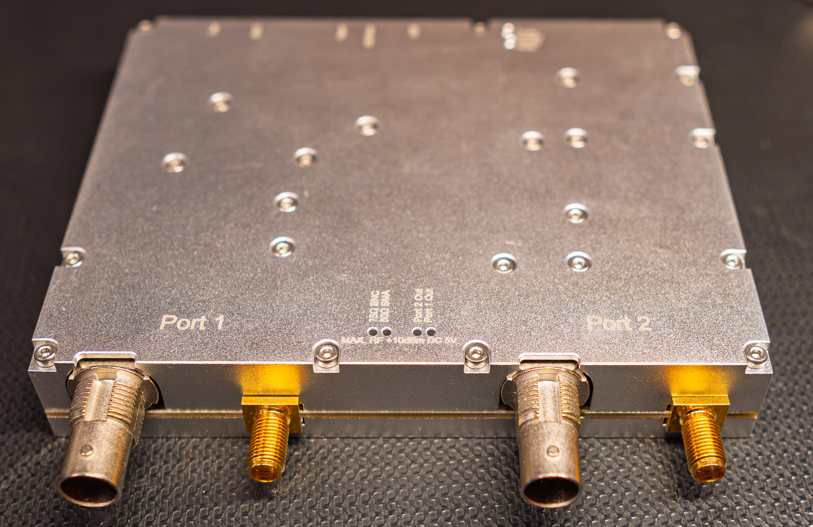
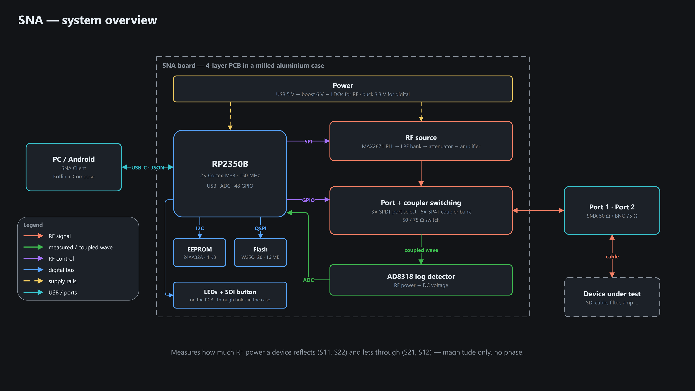
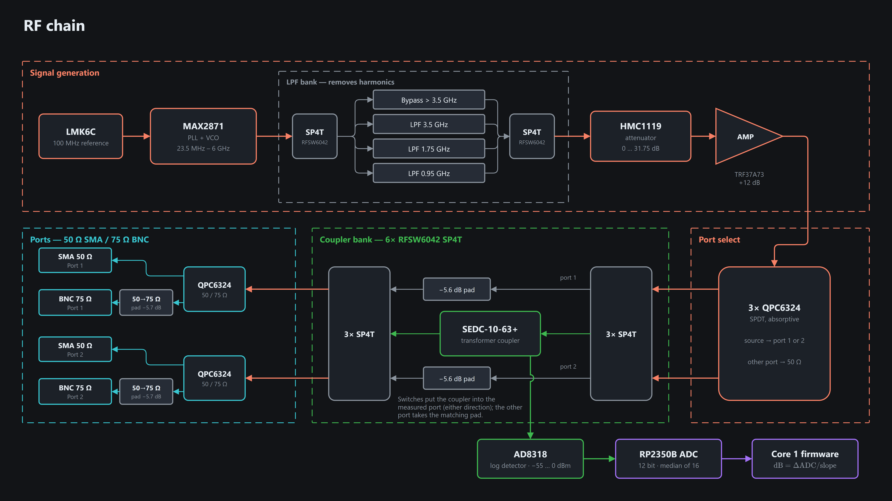

# SNA — scalar network analyzer

A 2-port scalar network analyzer from 50 MHz to 6 GHz with switchable 50 Ω (SMA) and 75 Ω (BNC)
ports, built as a school project ("mini IPA"). It measures S11/S21/S12/S22 magnitude, stores its
calibration on the device, and can check SDI coax cables on its own with the test button on the board
(pressed through a hole in the case).

**Release v1.0.0** — features in the [CHANGELOG](CHANGELOG.md), builds on the
[releases page](https://github.com/ml3rc/SNA/releases).





## What's inside

- **RF source:** MAX2871 synthesizer → switchable LPF bank → HMC1119 7-bit attenuator →
  TRF37A73 amplifier → port select.
- **Receiver:** one SEDC-10-63+ directional coupler shared by both ports and directions through
  RF switches, read by an AD8318 log detector on the MCU's ADC.
- **Ports:** SMA (50 Ω) and BNC (75 Ω, through a 50→75 Ω pad) per port.
- **MCU:** RP2350B, USB-C (power and host link), 24AA32A EEPROM for the 8 SLOT calibration sets
  (port × direction × impedance) and the SDI test thresholds, SWD header J202.
- **Enclosure:** milled aluminium, PCB sandwiched between top and bottom halves.



## Repository

```text
Altium/              schematic + 4-layer PCB (SNA.PrjPcb)
  SNAPCBVersion-FAB/   Gerbers
  SNAPCBVersion-INT/   schematic, layout, assembly PDFs and BOM
Fusion360/exp/       enclosure: STEP, Fusion archive, laser DXF, drawing, render
Software/
  firmware/          C11 · Pico SDK 2.2.0 · TinyUSB, RP2350B, dual core
  client/            Kotlin/Compose Multiplatform app: desktop (JVM) and Android
docs/                diagram-first docs: API, firmware, hardware, presentation
  measurements/      scope captures of the output signal, LibreVNA comparison
  pictures/          photos of the board and the case
```

## Versions

| Part | Version | Notes |
|---|---|---|
| Firmware | 1.0.0 | protocol 3 · EEPROM format 3 |
| Desktop client | 1.0.0 | needs protocol 3 · Windows MSI, `.deb`/`.dmg` from source |
| Android client | 1.0.0 (versionCode 11) | needs protocol 3 · USB OTG |
| PCB | 1.0 | |

Firmware and client talk JSON lines over USB CDC-ACM (VID:PID `CAFE:4001`); the client refuses
firmware with any other protocol version.

## Downloads

Builds are attached to each [GitHub release](https://github.com/ml3rc/SNA/releases):

- `sna_firmware.uf2` — firmware
- Windows installer (`.msi`) — desktop client
- Android APK — client for phones/tablets with USB OTG

Linux (`.deb`) and macOS (`.dmg`) packages are not published; build them from source (below).
The installers are unsigned, so Windows and Android warn about an unknown publisher.

## Quick start

1. **Flash the firmware:** hold BOOTSEL while plugging in USB (or send `{"cmd":"bootsel"}` to running
   firmware) and copy `sna_firmware.uf2` onto the drive that appears.
2. **Install the client** from the release and connect the SNA with a USB data cable.
3. **Calibrate** each impedance in the Calibration tab (Open/Short per port, Thru), then sweep.

### Building from source

1. **Firmware** (WSL/Linux, [devenv](https://devenv.sh)):
   `cd Software/firmware && devenv shell fw-build` → `build/sna_firmware.uf2`. It can also be
   programmed over SWD (J202) with OpenOCD.
2. **Client** (JDK 17–21): `cd Software/client && gradlew.bat :composeApp:run`; installers with
   `:composeApp:packageMsi` (`packageDeb`/`packageDmg` on Linux/macOS) and the Android APK with
   `:composeApp:assembleDebug`.

Details, toolchain setup and tests: [firmware README](Software/firmware/README.md),
[client README](Software/client/README.md).

## Documentation

| | |
|---|---|
| [docs](docs/README.md) | Overview and index |
| [RF basics](docs/presentation/README.md#rf-basics) | Animations: transmission lines, reflections, S-parameters |
| [Measurements](docs/measurements/README.md) | Output signals, LibreVNA comparison |
| [Pictures](docs/pictures/README.md) | Board and case photos |
| [API](docs/api/README.md) | USB JSON API: framing, modes, commands, errors |
| [Firmware](docs/firmware/README.md) | Architecture, RF chain, sweep, calibration, boot, LEDs & SDI button |
| [Hardware](docs/hardware/README.md) | Schematic sheets, power tree, MCU, RF chain, PCB |
| [PROTOCOL.md](docs/firmware/protocol/PROTOCOL.md) | Wire protocol, source of truth for firmware and client |
| [PINMAP.md](docs/firmware/protocol/PINMAP.md) | RP2350B pin map |
| [EEPROM_LAYOUT.md](docs/firmware/protocol/EEPROM_LAYOUT.md) | EEPROM byte layout |
| [Presentation](docs/presentation/README.md) | draw.io slide diagrams and Manim animations |

## Limitations

- Scalar only: magnitude, no phase, so calibration cannot correct errors that need phase.
- The detector slope is one value for the whole band; the settling times are conservative estimates,
  not measured limits.
- Power meter readings are approximate, uncalibrated dBm.
- The PCB has loss, and with this design it is not suitable for measurements that need to be accurate.

## Acknowledgements

The RF architecture, PCB stackup and several firmware details (e.g. the MAX2871 charge-pump
linearity mode) follow [LibreVNA](https://github.com/jankae/LibreVNA), which also serves as the
reference instrument for verification.

## License

[MIT](LICENSE), covering the software, the hardware design files and the documentation.
The vendored [cJSON](Software/firmware/src/third_party/cJSON/) keeps its own MIT license.
