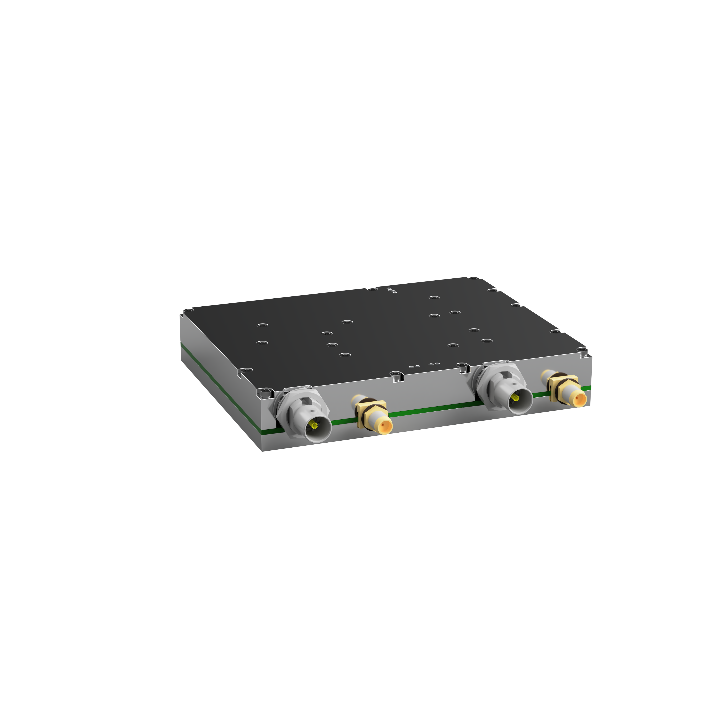

# SNA — scalar network analyzer

A 2-port scalar network analyzer from 50 MHz to 6 GHz with switchable 50 Ω (SMA) and 75 Ω (BNC)
ports, built as a school project ("mini IPA"). It measures S11/S21/S12/S22 magnitude, stores its
calibration on the device, and can check SDI coax cables on its own with a front-panel button.




## What's inside

- **RF source:** MAX2871 synthesizer → switchable LPF bank → HMC1119 7-bit attenuator →
  TRF37A73 amplifier → port select.
- **Receiver:** one SEDC-10-63+ directional coupler shared by both ports and directions through
  RF switches, read by an AD8318 log detector on the MCU's ADC.
- **Ports:** SMA (50 Ω) and BNC (75 Ω, through a 50→75 Ω pad) per port.
- **MCU:** RP2350B, USB-C (power and host link), 24AA32A EEPROM for the 8 SLOT calibration sets
  (port × direction × impedance) and the SDI test thresholds, SWD header J202.
- **Enclosure:** milled aluminium, PCB sandwiched between top and bottom halves.


## Repository

```text
Altium/              schematic + 4-layer PCB (SNA.PrjPcb)
  SNAPCBVersion-FAB/   Gerbers
  SNAPCBVersion-INT/   schematic, layout, assembly PDFs and BOM
Fusion360/exp/       enclosure: STEP, Fusion archive, laser DXF, drawing, render
Measurements/        scope captures of the output signal per port, frequency and level
Software/
  firmware/          C11 · Pico SDK 2.2.0 · TinyUSB, RP2350B, dual core
  client/            Kotlin/Compose Multiplatform app: desktop (JVM) and Android
  docs/              diagram-first docs: API, firmware, hardware, presentation
```

## Versions

| Part | Version | Notes |
|---|---|---|
| Firmware | 0.4.1 | protocol 3 · passes host tests, not yet tested on hardware |
| Desktop client | 1.4.0 | needs protocol 3 |
| Android client | 0.4.0 | needs protocol 3 |
| PCB | 1.0 | see [hardware errata](#known-hardware-issues) |

Firmware and client talk JSON lines over USB CDC-ACM (VID:PID `CAFE:4001`); the client refuses
firmware with any other protocol version.

## Quick start

1. **Build the firmware** (WSL/Linux, [devenv](https://devenv.sh)):
   `cd Software/firmware && devenv shell fw-build` → `build/sna_firmware.uf2`.
2. **Flash it:** hold BOOTSEL while plugging in USB and copy the `.uf2` onto the drive, or program
   the `.elf` over SWD (J202) with OpenOCD.
3. **Run the client** (JDK 17–21): `cd Software/client && gradlew.bat :composeApp:run`.
4. **Calibrate** each impedance in the Calibration tab (Open/Short per port, Thru), then sweep.

Details, toolchain setup and tests: [firmware README](Software/firmware/README.md),
[client README](Software/client/README.md).

## Documentation

| | |
|---|---|
| [Software/docs](Software/docs/README.md) | Overview and index |
| [API](Software/docs/api/README.md) | USB JSON API: framing, modes, commands, errors |
| [Firmware](Software/docs/firmware/README.md) | Architecture, RF chain, sweep, calibration, boot, LEDs & SDI button |
| [Hardware](Software/docs/hardware/README.md) | Schematic sheets, power tree, MCU, RF chain, PCB |
| [PROTOCOL.md](Software/docs/firmware/protocol/PROTOCOL.md) | Wire protocol, source of truth for firmware and client |
| [PINMAP.md](Software/docs/firmware/protocol/PINMAP.md) | RP2350B pin map |
| [EEPROM_LAYOUT.md](Software/docs/firmware/protocol/EEPROM_LAYOUT.md) | EEPROM byte layout |
| [Presentation](Software/docs/presentation/README.md) | draw.io slide diagrams and Manim animations |

## Limitations

- Scalar only: magnitude, no phase, so calibration cannot correct errors that need phase.
- The detector slope is one value for the whole band; settling times and LPF boundaries still need
  bench characterization.
- Power meter readings are approximate, uncalibrated dBm.

## Known hardware issues

- **Q202/Q203 (BSS84AK):** the footprint has drain and source swapped, so the body diode always
  lights the drain-side LED. Needs a hardware fix (rework or next PCB revision).

## Acknowledgements

The RF architecture, PCB stackup and several firmware details (e.g. the MAX2871 charge-pump
linearity mode) follow [LibreVNA](https://github.com/jankae/LibreVNA), which also serves as the
reference instrument for verification.
