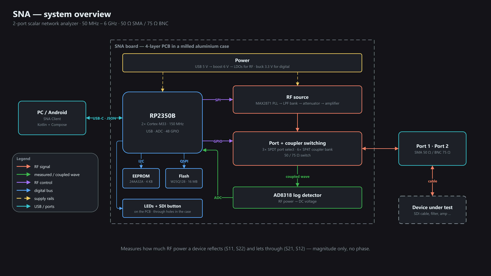

# SNA documentation

2-port scalar network analyzer, 50 MHz – 6 GHz, 50 Ω / 75 Ω. Firmware 0.4.x · protocol 3 · client 1.4.x.

Diagram-first: every page is a set of slides-ready diagrams with a few lines of text. All diagrams are draw.io
sources in [presentation/diagrams/](presentation/diagrams/), exported to PNG/SVG for the pages and the slides
(see [presentation/README.md](presentation/README.md)).

| | Page | Shows |
|---|---|---|
| **API** | [api/README.md](api/README.md) | USB JSON API: framing, modes, commands, sequences, errors, client library |
| **Firmware** | [firmware/README.md](firmware/README.md) | Architecture, RF chain, modes, sweep, calibration, boot, LEDs & SDI button |
| **Hardware** | [hardware/README.md](hardware/README.md) | Altium design: sheets, power, MCU, RF chain, pads, PCB |
| **Presentation** | [presentation/README.md](presentation/README.md) | draw.io slide diagrams + Manim animations (dark theme, EN + DE) |
| Spec | [firmware/protocol/PROTOCOL.md](firmware/protocol/PROTOCOL.md) | Full wire protocol (source of truth for firmware and client) |
| Spec | [firmware/protocol/PINMAP.md](firmware/protocol/PINMAP.md) | RP2350B pin map |
| Spec | [firmware/protocol/EEPROM_LAYOUT.md](firmware/protocol/EEPROM_LAYOUT.md) | EEPROM byte layout |

## The system in one picture



## Repository

```text
Software/
├── firmware/            C11 · Pico SDK · TinyUSB (RP2350B)
├── client/              Kotlin Multiplatform (desktop + Android)
└── docs/
    ├── api/             wire API + SnaClient
    ├── firmware/        firmware pages
    │   └── protocol/    PROTOCOL · PINMAP · EEPROM_LAYOUT  ← implemented by firmware and client
    ├── hardware/        Altium design
    └── presentation/    draw.io diagrams, Manim animations, German exports (de/)
```
