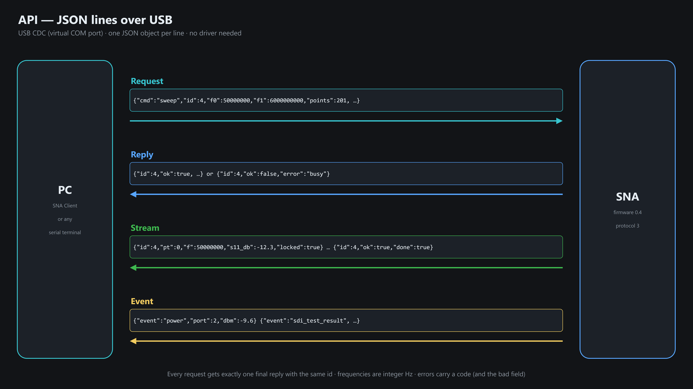
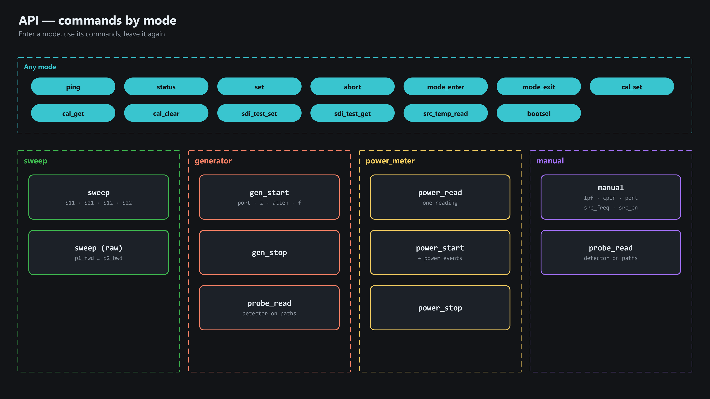
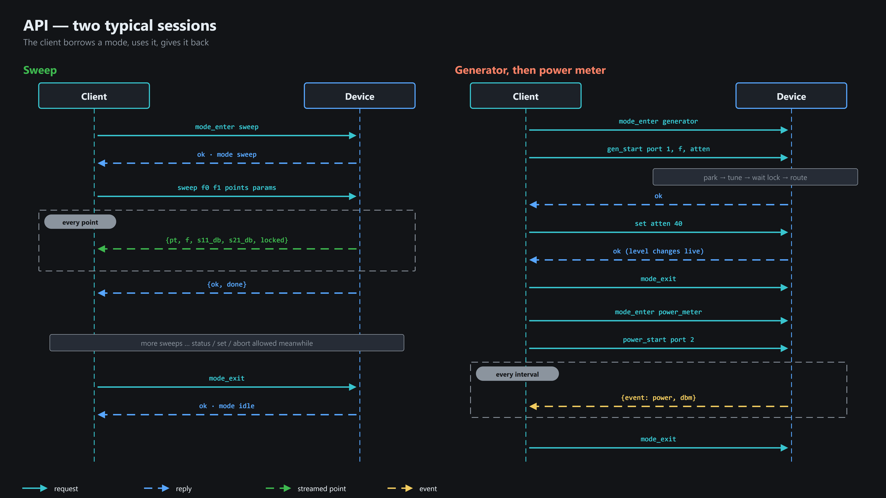
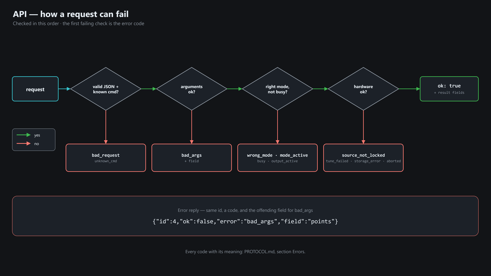
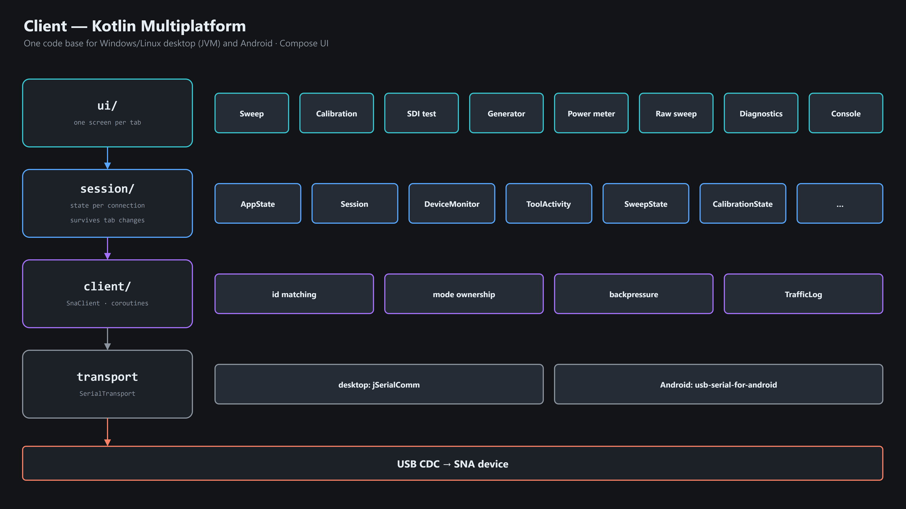

# API — USB JSON protocol

Quick visual reference. Full spec: [../firmware/protocol/PROTOCOL.md](../firmware/protocol/PROTOCOL.md).

## Transport & framing

- USB CDC-ACM (virtual COM port), no driver. One JSON object per line.
- Every request → **exactly one** final reply, matched by `id`.
- Frequencies: integer Hz. Level `atten`: 0..127 (0.25 dB steps, 127 = minimum).

## Modes — who owns the RF hardware

`mode_exit` (or USB disconnect) cancels whatever runs and parks the output.

## Command map

| Command | Purpose | Key args |
|---|---|---|
| `ping` | identify | → `fw`, `proto`, `hw_rev` |
| `status` | current state | → `mode`, `sweeping`, `z`, `port`, `atten` |
| `set` | change level / impedance live | `z` 50\|75, `atten` |
| `sweep` | measure S11/S21/S12/S22 | `f0`, `f1`, `points` ≤ 4096, `log`, `z`, `atten`, `params` |
| `abort` | stop sweep | — |
| `gen_start` / `gen_stop` | CW generator | `port`, `z`, `atten`, `f` |
| `power_read` / `power_start` | power meter | `port`, `z`, `interval_ms` |
| `probe_read` | detector on each coupler path | `paths` |
| `manual` | single RF block | `block`, `value` |
| `cal_*` | 8 calibration curves in EEPROM | `set`, `f0`, `f1`, `points` |
| `sdi_test_*` | on-board test points | `points` ≤ 15 |

## Two typical sessions

## Errors

## Client library (`SnaClient`, Kotlin)

| Wire | `SnaClient` |
|---|---|
| `mode_enter` / `mode_exit` | `acquireMode` / `releaseMode` / `withMode { … }` |
| `sweep` | `sweep(...)`, `sweepRaw(...)` → `Flow` of points |
| `gen_start` / `gen_stop` | `genStart`, `genStop` |
| `power_read` / `power_start` | `powerRead`, `powerStream(...)` → `Flow` |
| `cal_*` / `sdi_test_*` | `calSet/Get/Clear`, `sdiTestSet/Get` |
| everything else | `ping`, `status`, `set`, `abort`, `probeRead`, `manual`, `srcTempRead`, `bootsel`, `sendRaw` |
