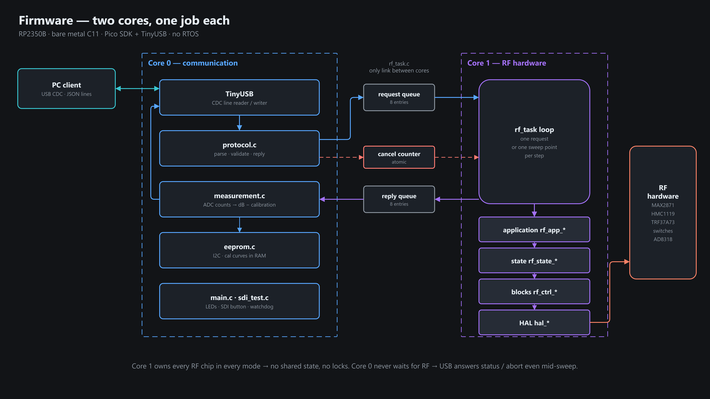
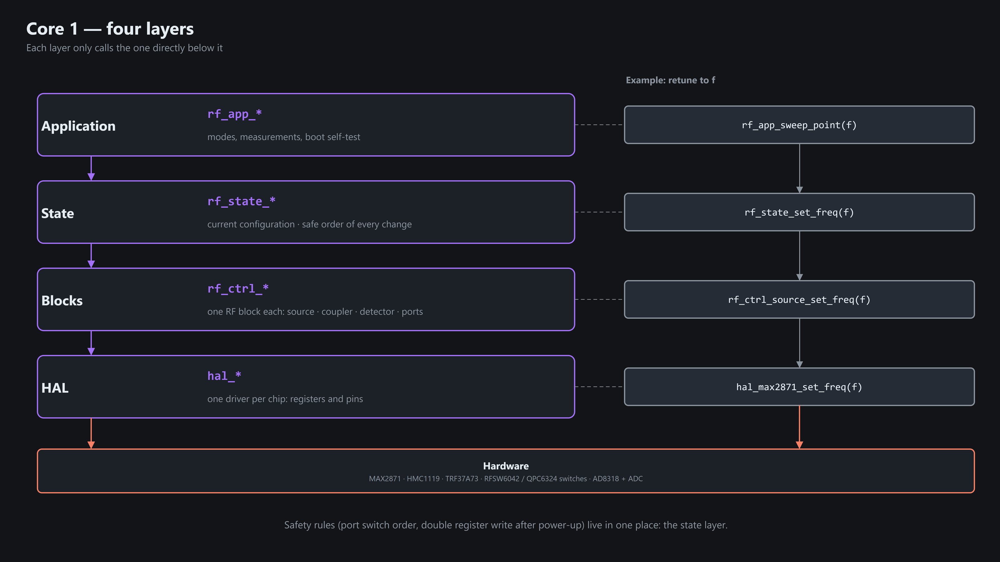

# Architecture

## Dual core split

- **Core 1 owns all RF hardware** in every mode → no shared state, no locks.
- **Core 0 never blocks on RF** → USB stays responsive (`status`, `abort` during a sweep).
- Core 1 measures point N+1 while core 0 converts and sends point N.

## Layers on core 1

Each layer only calls the one directly below.

## Core link (`rf_task.c`)

- Core 0 posts a request (tag, `cancel_seq`) to the request queue (8); core 1 takes them in order.
- Core 1 streams sweep points, then exactly one final reply with a status snapshot, through the reply queue (8).
  Core 0 drains it on every main-loop pass.
- Full reply queue → core 1 waits (no lost points = backpressure).
- `rf_task_cancel()` = `cancel_seq++` → cancels everything sent before it. Used on `abort`, `mode_exit`,
  disconnect and a 2 s host stall.
