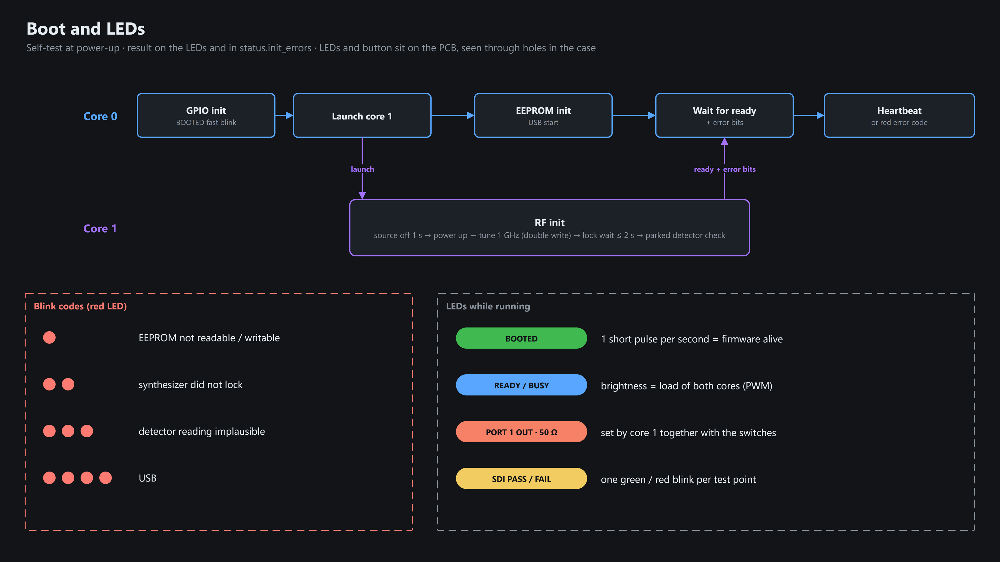
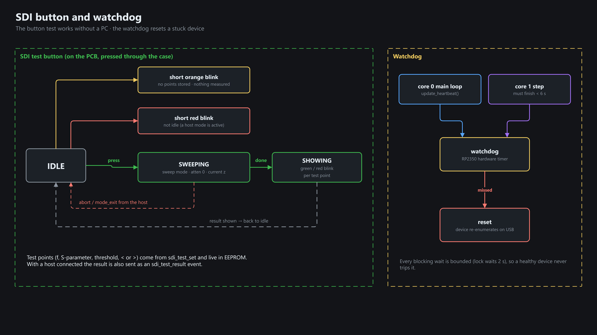

# Boot, LEDs & SDI button

There is no separate front panel: the LEDs and the SDI test button sit on the PCB, and the milled aluminium case has
vertical holes above them (LEDs show through, the button is pressed through the case).

## Boot and LEDs

## SDI test button (works without a PC) and watchdog

