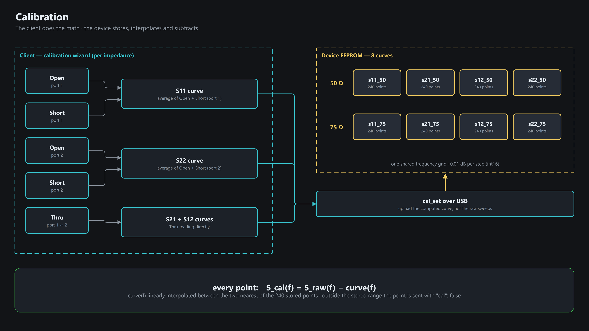
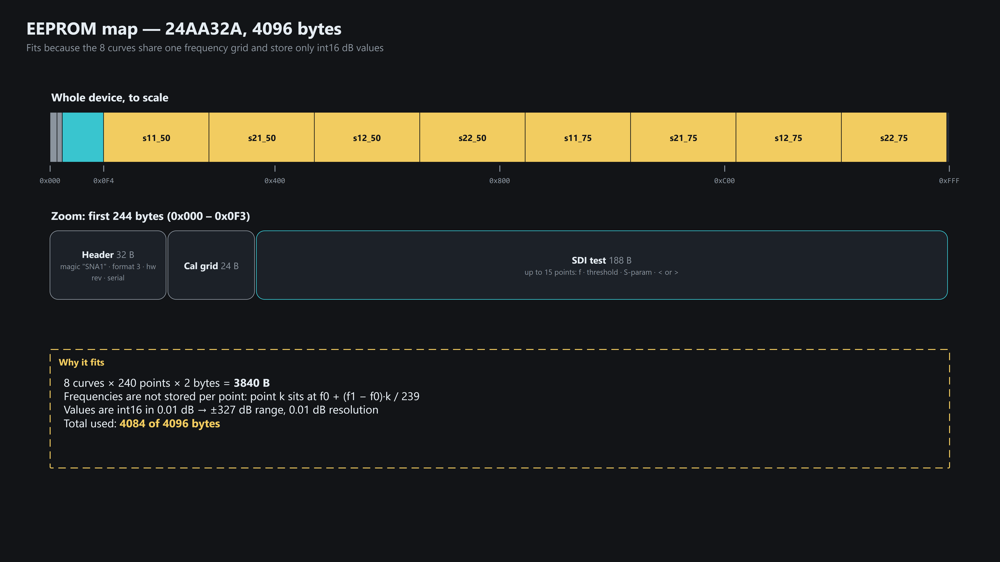

# Calibration

## Who does what

The device only stores, interpolates and subtracts. All the math is in the client.
All 8 sets (S11/S21/S12/S22 × 50/75 Ω) share one frequency grid `[f0, f1]`, 240 evenly spaced points,
0.01 dB resolution (`int16`).

## EEPROM (24AA32A, 4 KB)

4084 / 4096 bytes used. Byte offsets: [protocol/EEPROM_LAYOUT.md](protocol/EEPROM_LAYOUT.md).
