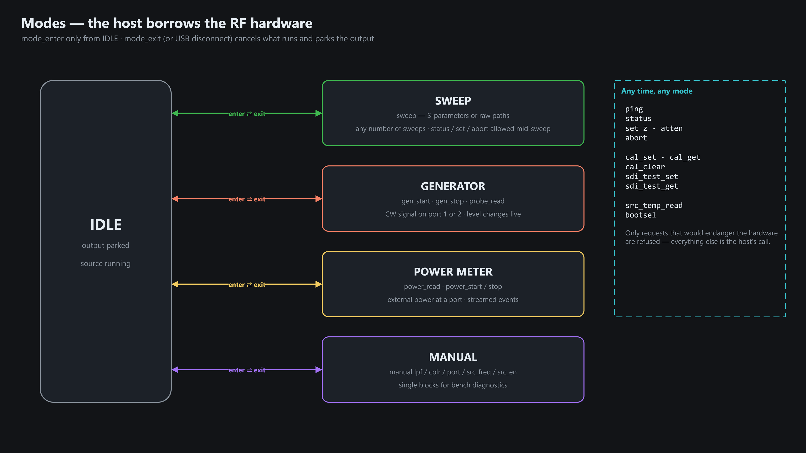
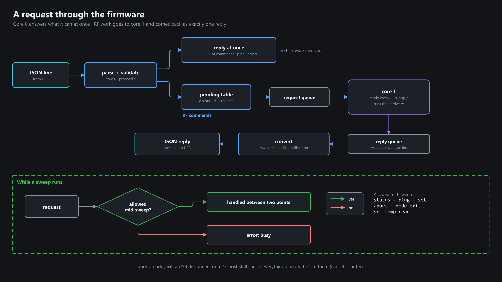

# Modes

One mode owns the RF hardware at a time. The host enters it, uses it, leaves it.

| Mode | Does | Output |
|---|---|---|
| IDLE | nothing | parked |
| SWEEP | S-parameter / raw-path sweeps (also entered by the SDI button) | routed per point |
| GENERATOR | CW signal at port 1/2 | on |
| PWR_DETECTOR | measure external power at a port | terminated |
| MANUAL | drive single blocks (bench diagnostics) | as set |

Settings (`set` z / atten) work in every mode, even mid-sweep. Only requests that endanger hardware are refused.

## Request path

