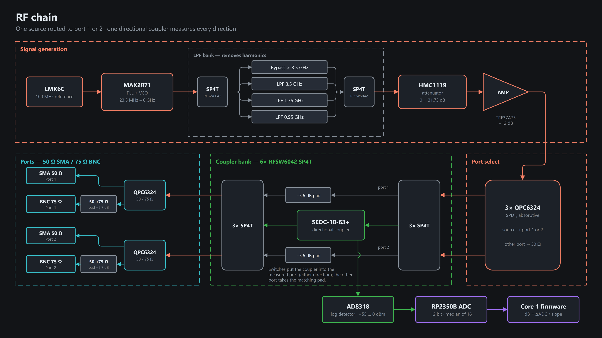
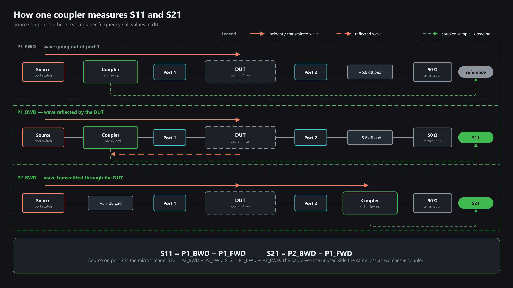
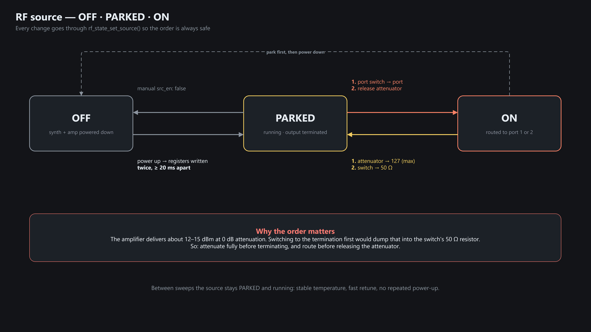

# RF chain

## Signal path

| Block | Chip | Firmware sets | Interface |
|---|---|---|---|
| Synthesizer | MAX2871 | frequency 23.5 MHz – 6 GHz, on/off | SPI + lock detect |
| Low-pass bank | 2 × RFSW6042 SP4T | bypass · 3.5 · 1.75 · 0.95 GHz (per frequency) | GPIO |
| Attenuator | HMC1119 | level 0–31.75 dB, 0.25 dB steps | 7-bit parallel |
| Amplifier | TRF37A73 | on/off | GPIO |
| Port switch | QPC6324 SPDT | terminated / port 1 / port 2 | GPIO |
| Coupler bank | SEDC-10-63+ coupler + 6 × RFSW6042 SP4T | which wave reaches the detector | GPIO |
| Impedance | QPC6324 SPDT + pads | 50 Ω SMA / 75 Ω BNC | GPIO |
| Detector | AD8318 | read power (−55…0 dBm) | ADC, 16-sample median |

## Coupler paths → S-parameters

Scalar only: every value is a power ratio in dB (no phase).

## Source safety states

| State | Synth + amp | Port switch | Attenuator |
|---|---|---|---|
| OFF | off | terminated | 127 |
| PARKED | running | terminated | 127 |
| ON | running | port 1 / 2 | set level |

Boot ends in PARKED (tuned to 1 GHz).
