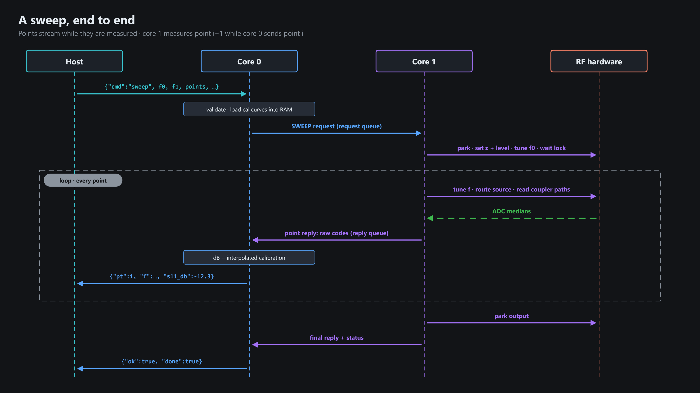
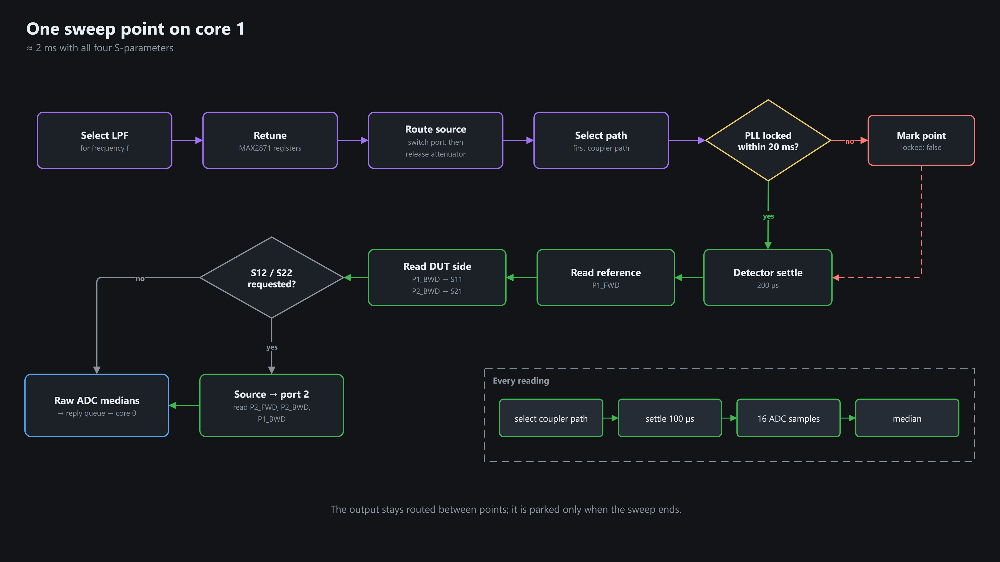
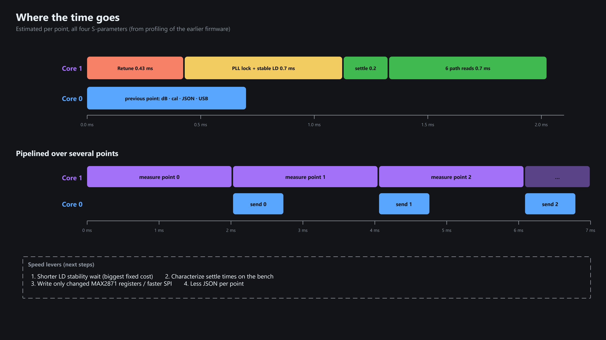
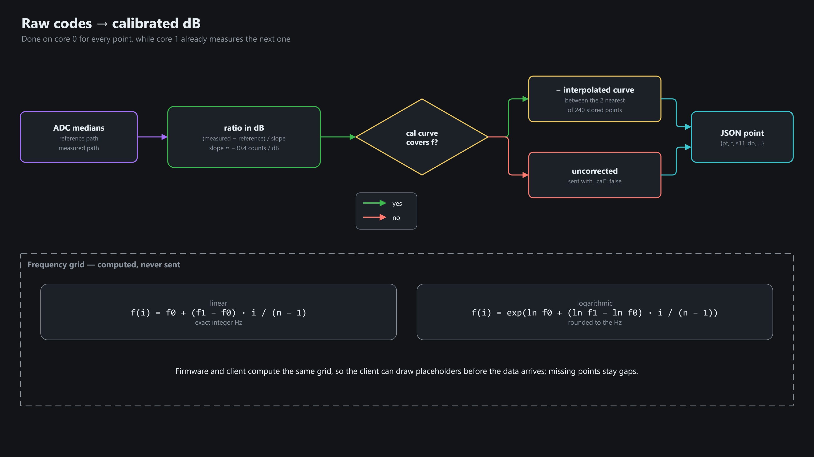

# Sweep

## End to end

Points are pipelined: core 1 measures point N+1 while core 0 sends point N.

## One point (core 1)

## Time per point (all 4 S-parameters, ≈ 2 ms)

## Raw codes → calibrated dB (core 0) and the frequency grid

