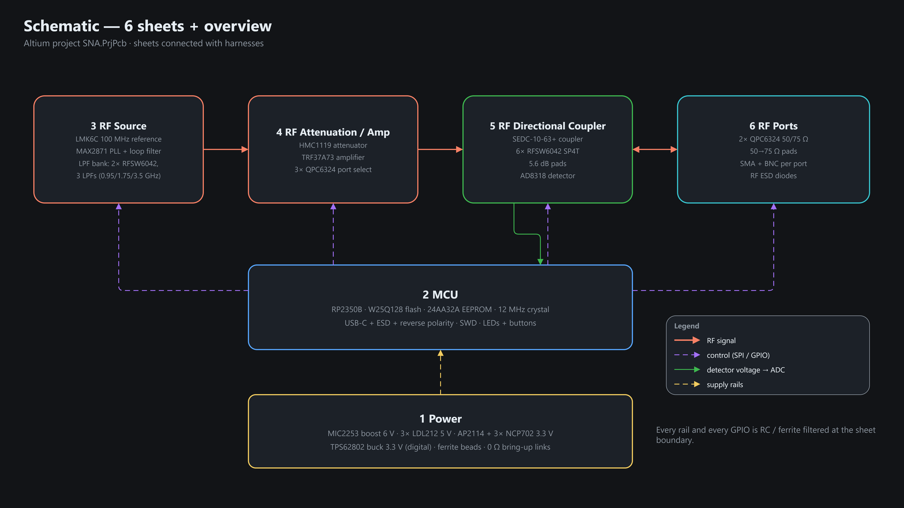
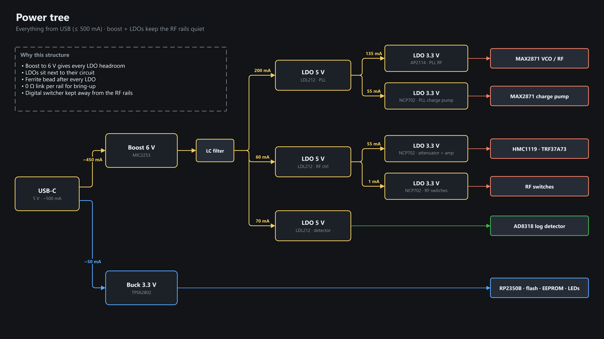
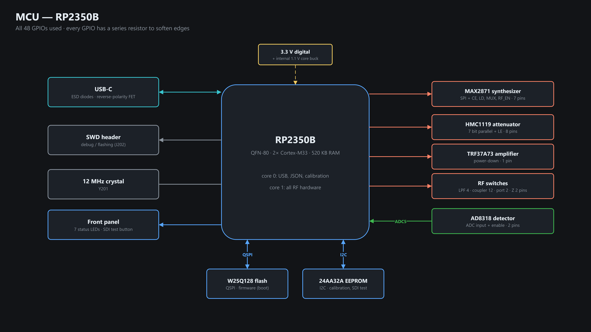
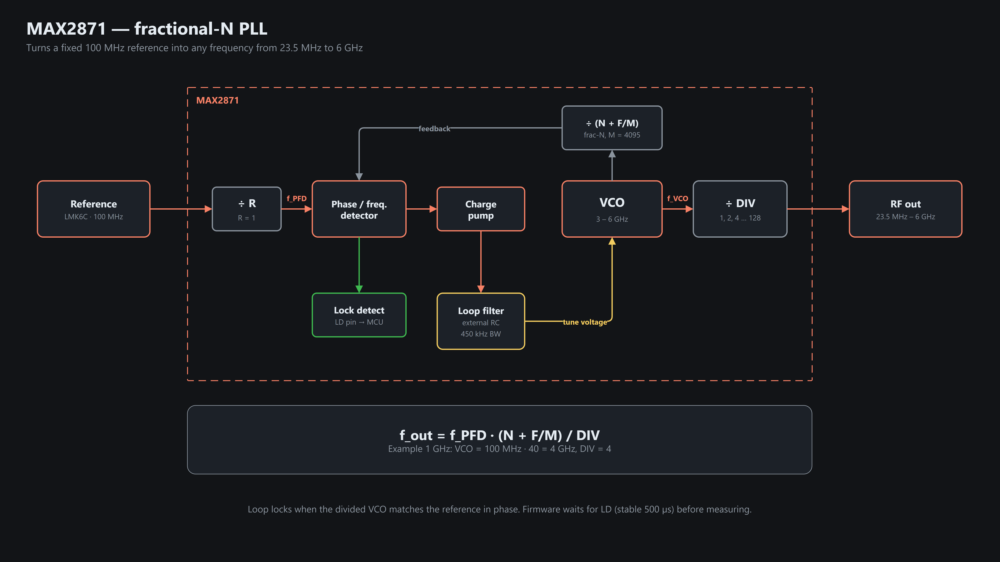
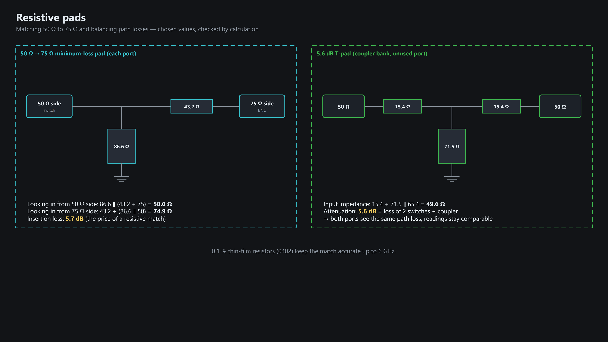
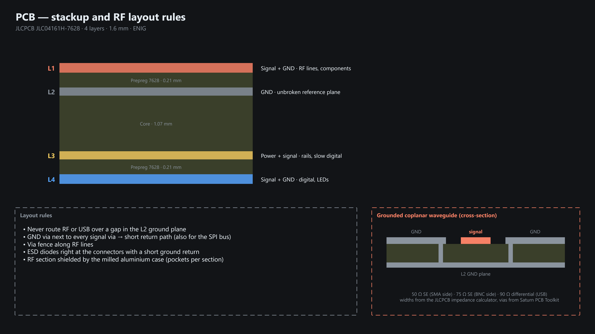

# Hardware (Altium)

4-layer PCB in a milled aluminium case. Altium project: [`Altium/SNA.PrjPcb`](../../../Altium/SNA.PrjPcb) ·
BOM / netlist / STEP: [`Altium/Project Outputs for SNA/`](../../../Altium/Project%20Outputs%20for%20SNA/) ·
pin map: [PINMAP.md](../firmware/protocol/PINMAP.md). Diagrams are draw.io sources in
[`../presentation/diagrams/`](../presentation/diagrams/); animations in
[`../presentation/animations/`](../presentation/README.md#animations).

## System

## Schematic sheets

| Sheet | Key parts |
|---|---|
| 1 Power | MIC2253 boost 6 V · 3× LDL212 5 V · AP2114 + 3× NCP702 3.3 V · TPS62802 buck 3.3 V |
| 2 MCU | RP2350B · W25Q128 flash · 24AA32A EEPROM · 12 MHz crystal · USB-C · SWD |
| 3 RF Source | LMK6C 100 MHz · MAX2871 · LPF bank (2× RFSW6042, 0.95 / 1.75 / 3.5 GHz LPFs) |
| 4 RF Attenuation / Amp | HMC1119 · TRF37A73 · 3× QPC6324 port select |
| 5 RF Directional Coupler | SEDC-10-63+ · 6× RFSW6042 · 5.6 dB pads · AD8318 |
| 6 RF Ports | 2× QPC6324 50/75 Ω · 50→75 Ω pads · SMA + BNC · RF ESD |

## Power

## MCU

## RF chain

### Synthesizer (MAX2871)

### Coupler bank → S-parameters

### Pads

## PCB

## Known erratum

Q202/Q203 (BSS84AK): footprint has drain and source swapped, so the body diode always lights the drain-side LED.
Hardware-only; fixed by rework, documented as a deviation in the report.
