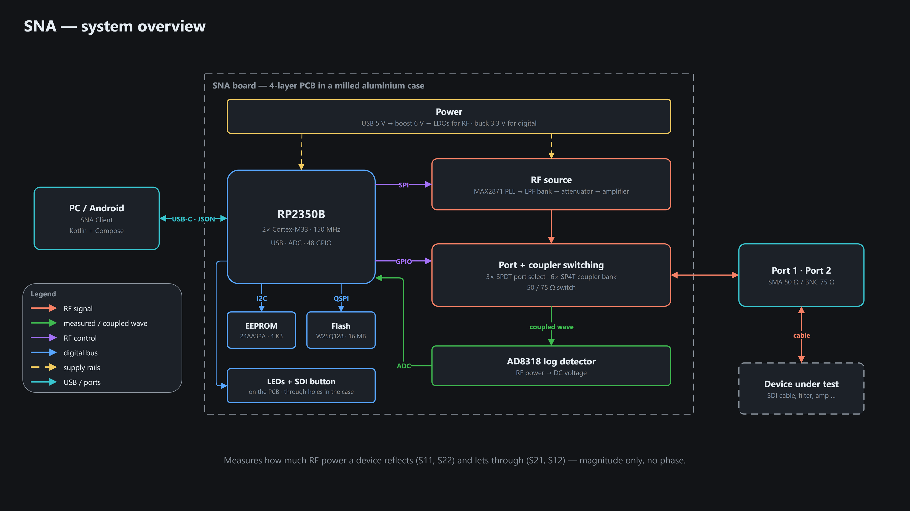

# SNA documentation · v1.0.0

2-port scalar network analyzer, 50 MHz – 6 GHz, 50 Ω / 75 Ω. Release **v1.0.0**: firmware 1.0.0 · protocol 3 ·
EEPROM format 3 · desktop and Android client 1.0.0 · PCB rev 1.0. Features: [CHANGELOG](../CHANGELOG.md); builds: [releases](https://github.com/ml3rc/SNA/releases).

Diagram-first: every page is a set of slides-ready diagrams with a few lines of text. All diagrams are draw.io
sources in [presentation/diagrams/](presentation/diagrams/), exported to PNG/SVG for the pages and the slides
(see [presentation/README.md](presentation/README.md)).

| | Page | Shows |
|---|---|---|
| **API** | [api/README.md](api/README.md) | USB JSON API: framing, modes, commands, sequences, errors, client library |
| **Firmware** | [firmware/README.md](firmware/README.md) | Architecture, RF chain, modes, sweep, calibration, boot, LEDs & SDI button |
| **Hardware** | [hardware/README.md](hardware/README.md) | Altium design: sheets, power, MCU, RF chain, pads, PCB |
| **Measurements** | [measurements/README.md](measurements/README.md) | Output signal scope captures, comparison with the LibreVNA |
| **Pictures** | [pictures/README.md](pictures/README.md) | Photos of the assembled board and the milled case |
| **Presentation** | [presentation/README.md](presentation/README.md) | draw.io slide diagrams + Manim animations (dark theme, EN + DE), incl. RF basics |
| Spec | [firmware/protocol/PROTOCOL.md](firmware/protocol/PROTOCOL.md) | Full wire protocol (source of truth for firmware and client) |
| Spec | [firmware/protocol/PINMAP.md](firmware/protocol/PINMAP.md) | RP2350B pin map |
| Spec | [firmware/protocol/EEPROM_LAYOUT.md](firmware/protocol/EEPROM_LAYOUT.md) | EEPROM byte layout |
| Client | [../Software/client/README.md](../Software/client/README.md) | Features, look, build, installers |
| Firmware build | [../Software/firmware/README.md](../Software/firmware/README.md) | Toolchain, build, flash, tests |

## The system in one picture



## RF basics (for readers new to RF)

Three short animations explain what the SNA measures, for people who know impedance over frequency but not
transmission lines: [TransmissionLine](presentation/animations/videos/TransmissionLine.mp4) (why a cable is a
line at high frequency, Z₀ = √(L′/C′)), [Reflections](presentation/animations/videos/Reflections.mp4)
(Γ = (Z_L − Z₀)/(Z_L + Z₀), open/short/matched, return loss, reflection over frequency) and
[SParameters](presentation/animations/videos/SParameters.mp4) (S11/S21/S12/S22, dB, typical values, how the
SNA turns powers into S-parameters).

## Repository

```text
SNA/
├── Altium/                  schematic + 4-layer PCB, Gerbers, assembly PDFs, BOM
├── Fusion360/exp/           enclosure: STEP, Fusion archive, laser DXF, drawing, render
├── Software/
│   ├── firmware/            C11 · Pico SDK · TinyUSB (RP2350B)
│   └── client/              Kotlin Multiplatform (desktop + Android)
└── docs/
    ├── api/                 wire API + SnaClient
    ├── firmware/            firmware pages
    │   └── protocol/        PROTOCOL · PINMAP · EEPROM_LAYOUT  ← implemented by firmware and client
    ├── hardware/            Altium design
    ├── measurements/        scope captures, LibreVNA comparison
    ├── pictures/            photos of board and case
    └── presentation/        draw.io diagrams, Manim animations, German exports (de/)
```
